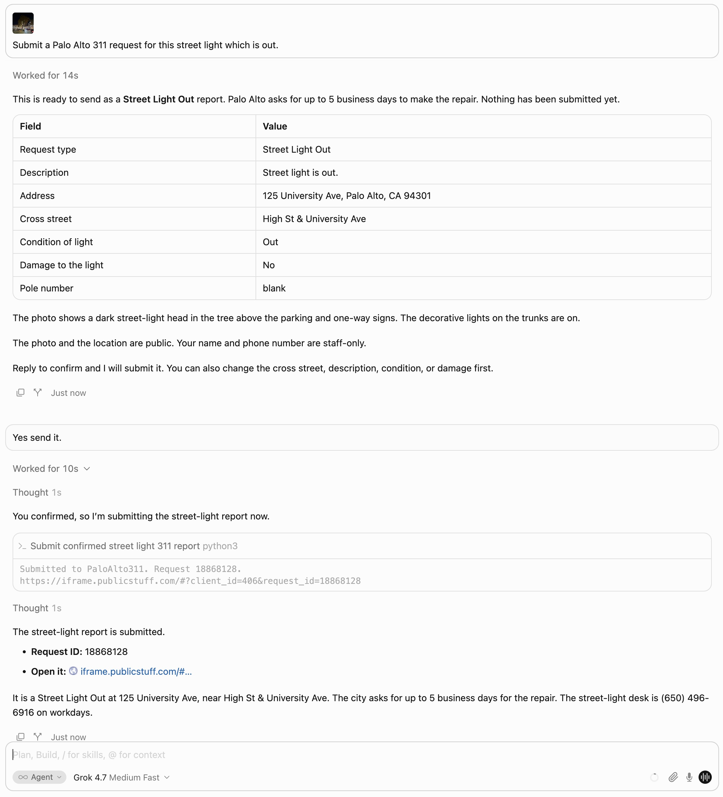
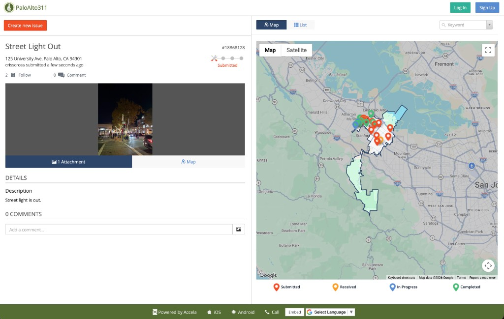

# file-311

File a city 311 report from a photo.

This repo files four cities: Palo Alto, Redwood City, Menlo Park, and Mountain View. Install it once, drop a photo into Cursor or Claude Code, and say what is wrong. The agent prepares the report. Nothing is sent until you agree.

Each skill files reports only inside its city. Palo Alto uses PaloAlto311. Redwood City uses myRWC. Menlo Park uses ACT Menlo Park. Mountain View uses Ask Mountain View, and the skill files a street light only.

Other places are listed in [docs/jurisdictions.md](docs/jurisdictions.md), with the system each one uses and how hard it is to add. We are looking for volunteers to help add skills for different cities/jurisdictions. Claim a row by putting your GitHub name and an ETA in that file, then open a pull request for the skill. 

Fig 1 shows an example of a Palo Alto 311 submission using the palo-alto skill for a street light out at 125 University Ave, November 4, 2026. Cursor asked me to confirm and then submitted the PaloAlto311 request [18868128](https://iframe.publicstuff.com/#?client_id=406&request_id=18868128) (Fig 2). The run is written up in [docs/palo-alto/runs.md](docs/palo-alto/runs.md#street-light-out-november-4-2026).


Fig 1. Cursor chat history where I attached the camera photo, read the preview, then confirmed.


Fig 2. Palo Alto 311 submission.

## Install

Install the `file-311` plugin from the marketplace. That is the preferred install in Cursor and Claude Code. The plugin installs Palo Alto, Redwood City, Menlo Park, Mountain View, and `file-311-common` together. The city script imports that library from the folder beside it.

Neither listing is available to install yet. Until one is approved, [install the skills directly](#install-the-skills-directly).

### Cursor

Submitted to the Cursor Marketplace on November 5, 2026. It is awaiting approval. Once it is listed:

1. Open Customize in the sidebar.
2. Search the Marketplace for `file-311`.
3. Choose Install, and install it for your user. A street-light report is not tied to one project.

### Claude Code

Not submitted yet. Someone with a Claude Pro plan needs to submit the repo at [claude.ai/directory/manage](https://claude.ai/directory/manage). Once it is listed:

1. Start Claude Code and run `/plugin`.
2. On the Discover tab, search for `file-311`.
3. Choose Install for you.

### Codex

Not submitted yet. OpenAI says: "We are not accepting more skills-only submissions at this time." See the [plugin guidelines](https://developers.openai.com/plugins/plugin-guidelines). The upload package is `dist/file-311-1.1.0.zip`, built with `python3 scripts/package_openai_zip.py`.

### Install the skills directly

Use this until a marketplace listing is approved. Global install is the default. Someone filing a street light is not inside a project repo.

You need Node 22.20 or newer. `npx` downloads and runs an npm package. `skills` is the [Vercel skills CLI](https://github.com/vercel-labs/skills), a separate tool from this repo. `@latest` means the newest published version of that CLI. The CLI then downloads `walkingcities/file-311` from GitHub and installs every skill in the repo: the shared library and each city. This does not install an npm package named file-311.

```bash
npx skills@latest add walkingcities/file-311 -g -a cursor -a claude-code -a codex -y
```

One copy of each skill is installed, and the other agents symlink to it. Updates are `npx skills update`.

To install only Palo Alto, name both the city skill and the library it imports:

```bash
npx skills@latest add walkingcities/file-311 --skill palo-alto --skill file-311-common -g -a cursor -a claude-code -a codex -y
```

Copy the folders yourself when Node is an extra requirement for a Python script. Copy `skills/file-311-common/`, `skills/palo-alto/`, `skills/redwood-city/`, `skills/menlo-park/`, and `skills/mountain-view/` into the same skills directory:

- Cursor: `~/.cursor/skills/`
- Claude Code: `~/.claude/skills/`
- Codex: `~/.agents/skills/`

## Use it

Drop the original photo into the chat. It must be the camera file, with location saved. On iPhone, Camera needs Precise Location. A screenshot or a re-saved image has no GPS, and the skill stops and asks for the original.

Say what is wrong, such as a street light that is out. The agent prepares a preview: request type, address, cross street, description, and the custom fields. It says which fields are public. A Palo Alto street light publishes the photo and the location. Name and phone are staff-only. A Redwood City report is private, including a street light. The photo and the location are still sent to the city.

Nothing is sent until you agree. The agent then prints the request id and the city request URL.

The city form means picking a category, typing the address, and filling the fields. Here that is a dropped photo and a confirmation. Palo Alto asks for up to 5 business days on a street light. The street-light desk is (650) 496-6916 on workdays. A power outage is a different report, (650) 496-6914. Redwood City's street-light confirmation says Public Works will update within 3 business days. The city publishes (650) 780-7464 for street problems.

A photo outside the chosen city is refused.

A Menlo Park street light uses ACT Menlo Park, request type Streetlight. The title, description, photo, and map pin are public. The SeeClickFix display name is public too. Lights on electric poles are PG&E, 1-877-660-6789.

A Mountain View street light uses Ask Mountain View, subtopic Street Lights. The letter and the photo are public records. The report is anonymous, and the city does not email a status. The address is written into the request text. Urgent street light outages are a call to Public Services, (650) 903-6329.

[docs/palo-alto/catalog.md](docs/palo-alto/catalog.md) lists every Palo Alto request type. A checkmark in its Run column links to the matching photo run in [docs/palo-alto/runs.md](docs/palo-alto/runs.md). [docs/redwood-city/catalog.md](docs/redwood-city/catalog.md) lists Redwood City. There is no Redwood City camera-photo run yet. [docs/menlo-park/catalog.md](docs/menlo-park/catalog.md) lists Menlo Park. A checkmark in its Run column links to the matching photo run in [docs/menlo-park/runs.md](docs/menlo-park/runs.md#street-light-out-november-7-2026). [docs/mountain-view/catalog.md](docs/mountain-view/catalog.md) lists Mountain View street lights. There is no Mountain View camera-photo run yet.

A JPEG works on any computer. The Python script reads its location. A HEIC photo needs a Mac: Swift reads the location, and `sips` converts it for upload. The Swift file is `skills/file-311-common/photo-gps.swift`. The compiled binary is not part of this repo. On Linux or Windows, export the photo as a JPEG.

## One-time setup

The first Palo Alto report asks for the PaloAlto311 email, password, name, and phone. You need an account on the city's 311 site, [Report an Issue](https://www.paloalto.gov/Residents/Services/Report-an-Issue). The password is passed only as an environment variable and is not saved. Email, name, phone, and the API key are stored in `~/.config/paloalto311/account.json` with mode `600`. Deleting that file signs you out. Later reports reuse it. Redwood City keeps its own account in `~/.config/myrwc/account.json`.

Menlo Park uses a different sign-in. Create an ACT Menlo Park account, then a CivicPlus personal access token from the API users page: https://seeclickfix.com/manage/users/2949404/api_users. Copy only the value that starts with `--`. Leave off the name and date shown before it. The token is saved in `~/.config/menlopark311/account.json` with mode `600`. Deleting that file signs you out.

Mountain View street lights do not use an account. The draft is kept in `~/.config/mountainview311/preview.json` with mode `600`.

## Run the script

From a clone of this repo:

```bash
python3 skills/palo-alto/scripts/paloalto311.py list street
python3 skills/palo-alto/scripts/paloalto311.py show "Street Light Out"
python3 skills/palo-alto/scripts/paloalto311.py prepare --photo "/path/to/photo.jpg"
PALOALTO311_EMAIL="..." PALOALTO311_PASSWORD="..." PALOALTO311_NAME="..." PALOALTO311_PHONE="..." \
  python3 skills/palo-alto/scripts/paloalto311.py login
python3 skills/palo-alto/scripts/paloalto311.py submit --confirm
```

`prepare` writes a preview and does not send it. `submit` sends only when `--confirm` is present.

Redwood City uses the same steps, with its own account:

```bash
python3 skills/redwood-city/scripts/myrwc.py list street
python3 skills/redwood-city/scripts/myrwc.py show "Street Light Outage"
python3 skills/redwood-city/scripts/myrwc.py prepare --photo "/path/to/photo.jpg"
MYRWC_EMAIL="..." MYRWC_PASSWORD="..." MYRWC_NAME="..." MYRWC_PHONE="..." \
  python3 skills/redwood-city/scripts/myrwc.py login
python3 skills/redwood-city/scripts/myrwc.py submit --confirm
```

Menlo Park uses the same two steps, with a token instead of a password:

```bash
python3 skills/menlo-park/scripts/menlopark311.py prepare --photo "/path/to/photo.jpg"
MENLOPARK311_TOKEN="..." python3 skills/menlo-park/scripts/menlopark311.py login
python3 skills/menlo-park/scripts/menlopark311.py submit --confirm
```

Mountain View street lights use the same prepare and confirm steps, with no login:

```bash
python3 skills/mountain-view/scripts/mountainview311.py prepare --photo "/path/to/photo.jpg"
python3 skills/mountain-view/scripts/mountainview311.py submit --confirm
```
