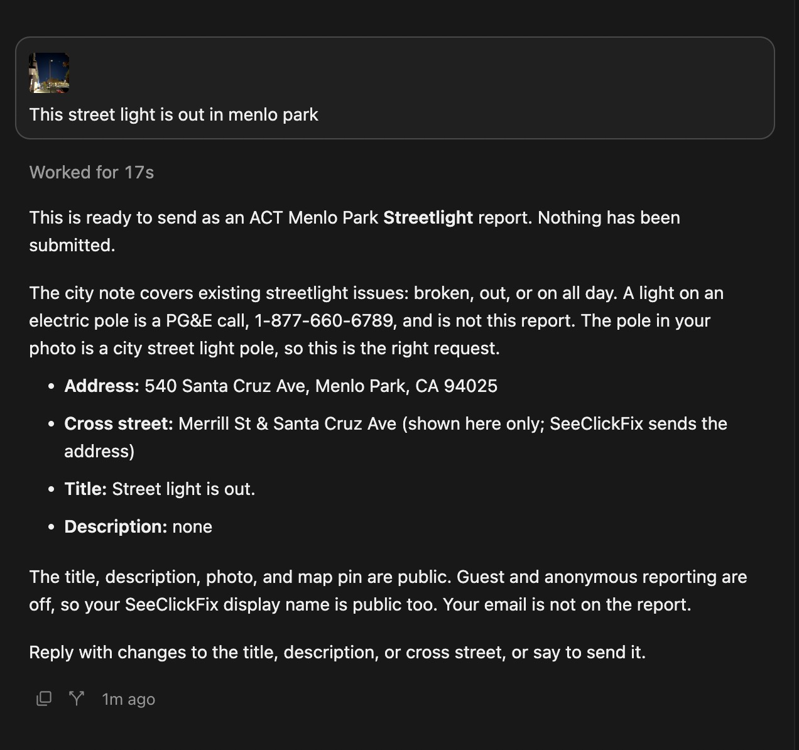
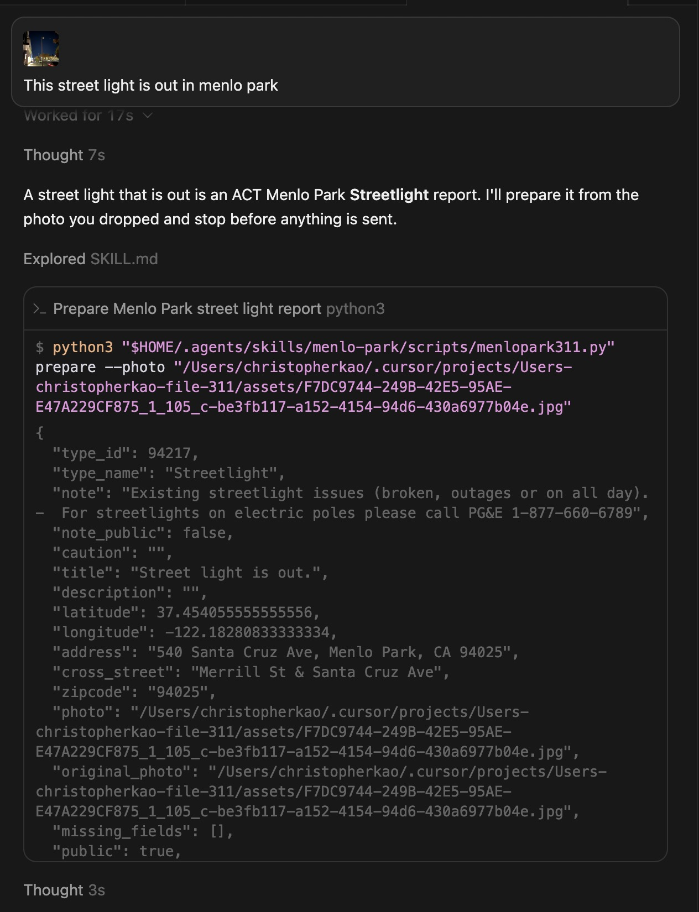
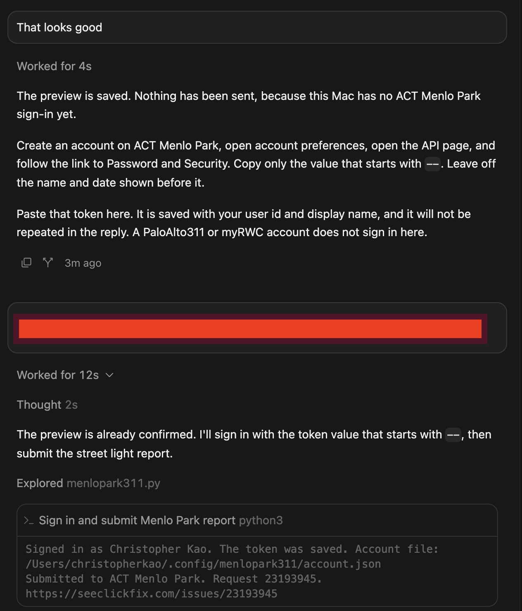
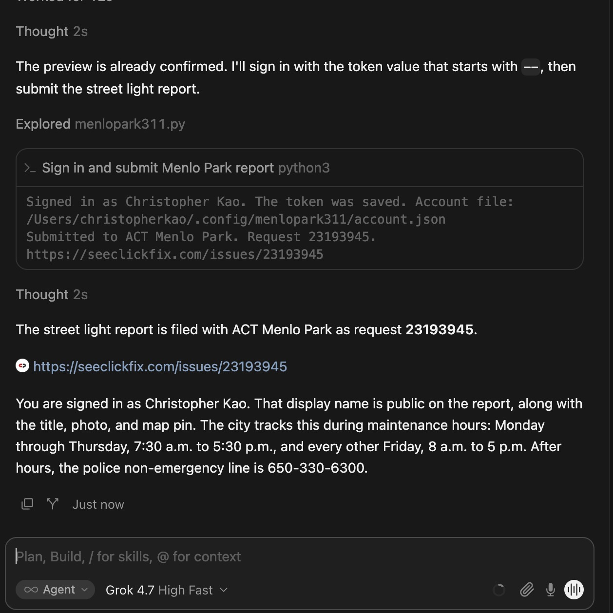

# Menlo Park 311 runs

Camera-photo runs for Menlo Park. This file does not cover other jurisdictions. [`catalog.md`](catalog.md) links here from the Run column.

The agent follows [`skills/menlo-park/SKILL.md`](../../skills/menlo-park/SKILL.md). `list` and `show` only read `catalog.json`. `prepare` calls the Esri geocoder and writes `~/.config/menlopark311/preview.json`. `submit --confirm` is the only command that files the report. It checks the pin, checks that SeeClickFix still offers the type for Menlo Park, then POSTs to `https://seeclickfix.com/api/v2/issues`. `login` is a separate call, and only when that account file is missing. It sends the personal access token and does not send a password.

Streetlight is also covered offline by [`tests/test_menlo_park_street_light.py`](../../tests/test_menlo_park_street_light.py). That test uses a stand-in photo and does not call the city.

## Street light out, November 7, 2026

Submitted. ACT Menlo Park request [23193945](https://seeclickfix.com/issues/23193945).

Catalog type: [Streetlight](catalog.md#streetlight), id 94217.

The photo is a night sidewalk on Santa Cruz Avenue. A tall city street-light pole stands at the curb with the head dark. Other lights farther down the street are on. A white Jeep is parked beside the pole, and a red car is at the right edge. The original camera file is `F7DC9744-249B-42E5-95AE-E47A229CF875_1_105_c-be3fb117-a152-4154-94d6-430a6977b04e.jpg`.

### Chat

**Christopher:** This street light is out in menlo park

**Assistant:** This is ready to send as an ACT Menlo Park Streetlight report. Nothing has been submitted.

The city note covers existing streetlight issues: broken, out, or on all day. A light on an electric pole is a PG&E call, 1-877-660-6789, and is not this report. The pole in the photo is a city street light pole, so this is the right request.

- Address: 540 Santa Cruz Ave, Menlo Park, CA 94025
- Cross street: Merrill St & Santa Cruz Ave (shown here only; SeeClickFix sends the address)
- Title: Street light is out.
- Description: none

The title, description, photo, and map pin are public. Guest and anonymous reporting are off, so the SeeClickFix display name is public too. Email is not on the report.





**Christopher:** That looks good

**Assistant:** The preview is saved. Nothing has been sent, because this Mac has no ACT Menlo Park sign-in yet. Create an account on ACT Menlo Park, open account preferences, open the API page, and follow the link to Password and Security. Copy only the value that starts with `--`. Leave off the name and date shown before it.



**Christopher:** Pasted the CivicPlus personal access token. The token is covered in the screenshot and is not written here.

**Assistant:** The street light report is filed with ACT Menlo Park as request 23193945. https://seeclickfix.com/issues/23193945



You are signed in as Christopher Kao. That display name is public on the report, along with the title, photo, and map pin.

### What the skill did

1. Streetlight is the skill's request type for a street light that is out, id 94217. The catalog note is "Existing streetlight issues (broken, outages or on all day). - For streetlights on electric poles please call PG&E 1-877-660-6789". `show` would list Issue Title as required and public, and Description and Image as optional and public. That lookup is local. It does not call SeeClickFix.

2. `prepare` used the original JPEG. The command was:

```bash
python3 skills/menlo-park/scripts/menlopark311.py prepare \
  --photo "/path/to/F7DC9744-249B-42E5-95AE-E47A229CF875_1_105_c-be3fb117-a152-4154-94d6-430a6977b04e.jpg"
```

`prepare` read the GPS from the JPEG in Python: 37.454055555555556, -122.18280833333334. It then called Esri's public reverse geocoder twice:

```
GET https://geocode.arcgis.com/arcgis/rest/services/World/GeocodeServer/reverseGeocode?f=json&location=-122.18280833333334,37.454055555555556
GET https://geocode.arcgis.com/arcgis/rest/services/World/GeocodeServer/reverseGeocode?f=json&featureTypes=StreetInt&location=-122.18280833333334,37.454055555555556
```

The first response had to be inside Menlo Park. It returned 540 Santa Cruz Ave, Menlo Park, CA 94025. The second, limited to street intersections, returned Merrill St & Santa Cruz Ave. The skill kept that corner in the preview. SeeClickFix has no cross-street field, so the address is what is sent. The title defaulted to `Street light is out.` The description was empty. It wrote the preview to `~/.config/menlopark311/preview.json` with mode 600. `prepare` does not send the report.

3. `~/.config/menlopark311/account.json` was missing, so this run signed in before submit. `login` sent the CivicPlus personal access token as `MENLOPARK311_TOKEN` and called `GET https://seeclickfix.com/api/v2/profile`. The saved file holds the token, user id, and display name, with mode 600. The display name on this run was Christopher Kao.

4. After the preview was confirmed and the account was saved, `submit --confirm` read that preview, called the same two reverse-geocode URLs again to check the pin was still in Menlo Park, and checked that SeeClickFix still offered Streetlight at that pin:

```
GET https://seeclickfix.com/api/v2/issues/new?lat=37.454055555555556&lng=-122.18280833333334
```

It then POSTed the report:

```
POST https://seeclickfix.com/api/v2/issues
Authorization: Bearer
Content-Type: multipart/form-data
```

The form included `lat`, `lng`, `address` 540 Santa Cruz Ave, Menlo Park, CA 94025, `request_type_id` 94217, `answers[summary]` set to `Street light is out.`, and the photo as `answers[issue_image]`. The description was empty, so `answers[description]` was left out. SeeClickFix returned request 23193945 and this URL:

https://seeclickfix.com/issues/23193945

