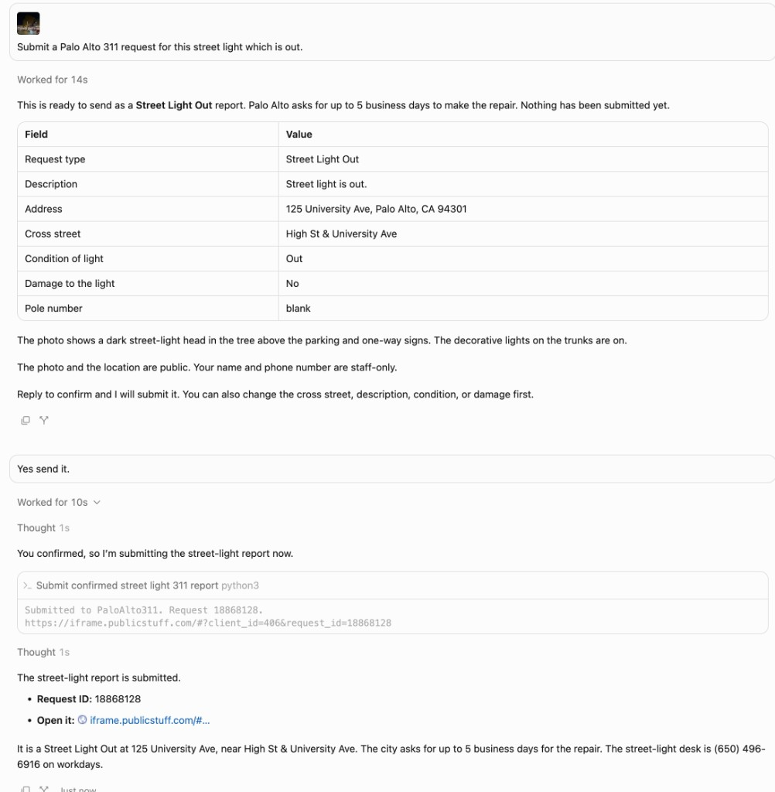
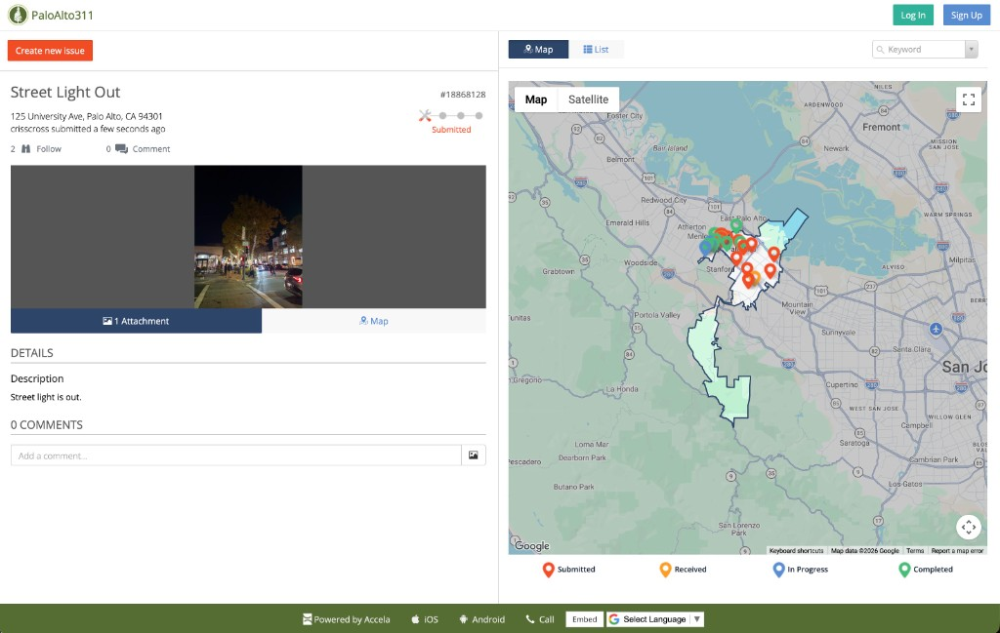

# Palo Alto 311 runs

Camera-photo runs for Palo Alto. Another city gets its own `docs/<city>/runs.md` next to that city's catalog. This file does not cover other jurisdictions. [`catalog.md`](catalog.md) links here from the Run column.

The agent follows [`skills/palo-alto/SKILL.md`](../../skills/palo-alto/SKILL.md). `list` and `show` only read `catalog.json`. `prepare` calls the Esri geocoder and writes `~/.config/paloalto311/preview.json`. `submit --confirm` is the only command that files the report. It POSTs to PaloAlto311. `login` is a separate POST, and only when that account file is missing.

## Fallen sign, November 3, 2026

Submitted. PaloAlto311 request [18864090](https://iframe.publicstuff.com/#?client_id=406&request_id=18864090).

Catalog type: [Traffic Signs Damaged or Obstructed](catalog.md#traffic-signs-damaged-or-obstructed), id 15503.

The photo is a green bike-lane wayfinding sign lying on the dirt shoulder, post down, beside a road with a railroad crossing and a 10 mph curve sign. The original camera file is `992FBCAD-1F89-4139-83A4-A89A9630121B_1_105_c-4832a9e1-6c3c-4b5d-a20f-bd006fd58e33.jpg`.

### Chat

**Christopher:** Dry run; do not submit. Report this sign to Palo Alto 311 that fell down. See attached photo.

**Assistant:** Dry run only. Nothing was submitted.

- Request type: Traffic Signs Damaged or Obstructed
- Address: 67 Palo Alto Ave, Palo Alto, CA 94301
- Cross street: Alma St & Palo Alto Ave
- Description: A green bike-lane wayfinding sign has fallen and is lying on the dirt shoulder beside the road. The post is down.
- Intersection (staff-only): Alma St & Palo Alto Ave

The photo and the location are public. This request type has no name or phone field. The intersection is the only staff-only field.

**Christopher:** Can you actually submit the 311 request, and if successful, update the example runs section?

**Assistant:** Submitted to PaloAlto311. Request 18864090. https://iframe.publicstuff.com/#?client_id=406&request_id=18864090

### What the skill did

1. The skill says to pick a request type from `catalog.json` before calling the city. A search for "sign" matched Traffic Signs Damaged or Obstructed (id 15503): "Report missing, bent and unreadable traffic signs." `show` would print one required field, Intersection (id 5128), and mark it staff-only. That lookup is local. It does not call PaloAlto311.

2. `prepare` used the original JPEG. The command was:

```bash
python3 skills/palo-alto/scripts/paloalto311.py prepare \
  --photo "/path/to/992FBCAD-1F89-4139-83A4-A89A9630121B_1_105_c-4832a9e1-6c3c-4b5d-a20f-bd006fd58e33.jpg" \
  --type "Traffic Signs Damaged or Obstructed" \
  --description "A green bike-lane wayfinding sign has fallen and is lying on the dirt shoulder beside the road. The post is down."
```

`prepare` read the GPS from the JPEG in Python: 37.44673888888889, -122.17004444444444. It then called Esri's public reverse geocoder twice:

```
GET https://geocode.arcgis.com/arcgis/rest/services/World/GeocodeServer/reverseGeocode?f=json&location=-122.17004444444444,37.44673888888889
GET https://geocode.arcgis.com/arcgis/rest/services/World/GeocodeServer/reverseGeocode?f=json&featureTypes=StreetInt&location=-122.17004444444444,37.44673888888889
```

The first response had to be inside Palo Alto. It returned 67 Palo Alto Ave, Palo Alto, CA 94301. The second, limited to street intersections, returned Alma St & Palo Alto Ave. The skill copied that corner into Intersection, field 5128, and wrote the preview to `~/.config/paloalto311/preview.json` with mode 600. `prepare` does not send the report.

3. `~/.config/paloalto311/account.json` was already present, so this run did not log in. A first report would set `PALOALTO311_EMAIL`, `PALOALTO311_PASSWORD`, `PALOALTO311_NAME`, and `PALOALTO311_PHONE` and run `login`, which POSTs `https://vc0.publicstuff.com/api/2.1/user_login` with `client_id` 406. The password is not saved. The saved file holds the email, name, phone, and API key.

4. After the preview was confirmed, `submit --confirm` read that preview and POSTed the report:

```
POST https://vc0.publicstuff.com/api/2.0/request_submit
PublicStuff-Client: 406
Content-Type: multipart/form-data
```

The form included `title`, `description`, `request_type_id` 15503, the photo latitude and longitude, the formatted address in `address`, `user_address`, and `long_address`, `zipcode` 94301, `space_id` 26742, `client_id` 406, `device` iframe, the saved API key, `has_image` 1, and the photo as `uploadedfile`. Intersection went out as `custom_field_5128`, with the corner JSON-encoded. The script treats the call as successful when `response.status.code` is 200. PaloAlto311 returned request 18864090 and this URL:

https://iframe.publicstuff.com/#?client_id=406&request_id=18864090

## Street light out, November 4, 2026

Submitted. PaloAlto311 request [18868128](https://iframe.publicstuff.com/#?client_id=406&request_id=18868128).

Catalog type: [Street Light Out](catalog.md#street-light-out), id 32794.

The photo is a night street on University Avenue. The street-light head in the tree above the parking and one-way signs is dark. The decorative lights on the trunks are on. The original camera file is `1C0E0130-9E65-4730-AEB6-EF06B89CA475_1_105_c-a77e9db1-41a9-44dc-bccd-b7692ba7fd37.jpg`.





### Chat

**Christopher:** Submit a Palo Alto 311 request for this street light which is out. See attached photo.

**Assistant:** This is ready to send as a Street Light Out report. Palo Alto asks for up to 5 business days to make the repair. Nothing has been submitted yet.

- Request type: Street Light Out
- Description: Street light is out.
- Address: 125 University Ave, Palo Alto, CA 94301
- Cross street: High St & University Ave
- Condition of light: Out
- Damage to the light: No
- Pole number: blank

The photo shows a dark street-light head in the tree above the parking and one-way signs. The decorative lights on the trunks are on.

The photo and the location are public. Name and phone are staff-only.

**Christopher:** Yes send it.

**Assistant:** Submitted to PaloAlto311. Request 18868128. https://iframe.publicstuff.com/#?client_id=406&request_id=18868128

### What the skill did

1. Street Light Out is the skill's default request type, id 32794. The catalog description is "Please allow 5 business days for us to make repairs." `show` would list Name (3266), Phone Number (3260), Light Location Address (3258), Cross Street (3259), Condition of Light (3257), and "Is there damage to the light?" (3263) as required and staff-only. Pole Number (3256) is optional. That lookup is local. It does not call PaloAlto311.

2. `prepare` used the original JPEG. The command was:

```bash
python3 skills/palo-alto/scripts/paloalto311.py prepare \
  --photo "/path/to/1C0E0130-9E65-4730-AEB6-EF06B89CA475_1_105_c-a77e9db1-41a9-44dc-bccd-b7692ba7fd37.jpg" \
  --description "Street light is out." \
  --condition Out \
  --damage No
```

`prepare` read the GPS from the JPEG in Python: 37.44413055555555, -122.16358055555555. It then called Esri's public reverse geocoder twice:

```
GET https://geocode.arcgis.com/arcgis/rest/services/World/GeocodeServer/reverseGeocode?f=json&location=-122.16358055555555,37.44413055555555
GET https://geocode.arcgis.com/arcgis/rest/services/World/GeocodeServer/reverseGeocode?f=json&featureTypes=StreetInt&location=-122.16358055555555,37.44413055555555
```

The first response had to be inside Palo Alto. It returned 125 University Ave, Palo Alto, CA 94301. The second, limited to street intersections, returned High St & University Ave. The skill copied the address into Light Location Address, field 3258, and the corner into Cross Street, field 3259. Condition of Light was `Out` and damage was `No`. Pole number stayed blank, so field 3256 was left out. It wrote the preview to `~/.config/paloalto311/preview.json` with mode 600. `prepare` does not send the report.

3. `~/.config/paloalto311/account.json` was already present, so this run did not log in. `prepare` and `submit` copy Name and Phone Number from that file into fields 3266 and 3260. A first report would set `PALOALTO311_EMAIL`, `PALOALTO311_PASSWORD`, `PALOALTO311_NAME`, and `PALOALTO311_PHONE` and run `login`, which POSTs `https://vc0.publicstuff.com/api/2.1/user_login` with `client_id` 406. The password is not saved. The saved file holds the email, name, phone, and API key.

4. After the preview was confirmed, `submit --confirm` read that preview, called the same two reverse-geocode URLs again to check the pin was still in Palo Alto, and POSTed the report:

```
POST https://vc0.publicstuff.com/api/2.0/request_submit
PublicStuff-Client: 406
Content-Type: multipart/form-data
```

The form included `title`, `description`, `request_type_id` 32794, the photo latitude and longitude, the formatted address in `address`, `user_address`, and `long_address`, `zipcode` 94301, `space_id` 26742, `client_id` 406, `device` iframe, the saved API key, `has_image` 1, and the photo as `uploadedfile`. Light Location Address went out as `custom_field_3258`, Cross Street as `custom_field_3259`, Condition of Light as `custom_field_3257`, and damage as `custom_field_3263`. Name and phone went out as `custom_field_3266` and `custom_field_3260`, filled from the account file. Each custom field value was JSON-encoded. The script treats the call as successful when `response.status.code` is 200. PaloAlto311 returned request 18868128 and this URL:

https://iframe.publicstuff.com/#?client_id=406&request_id=18868128
