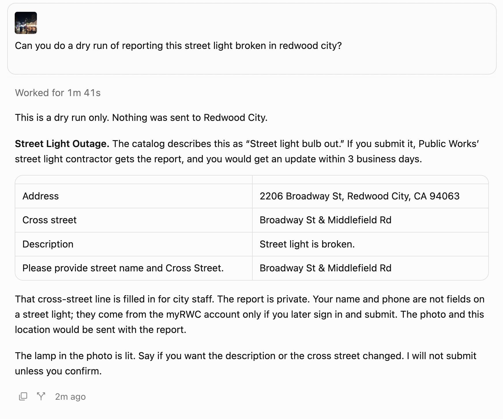
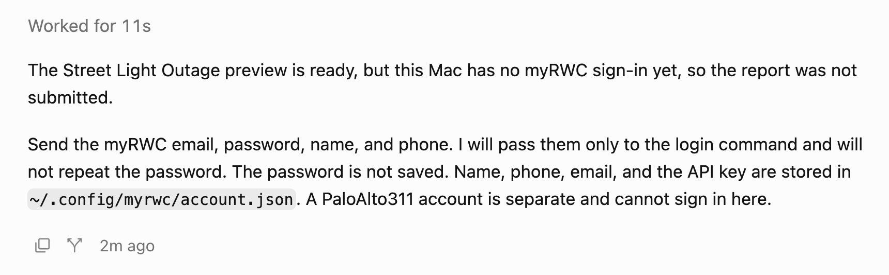
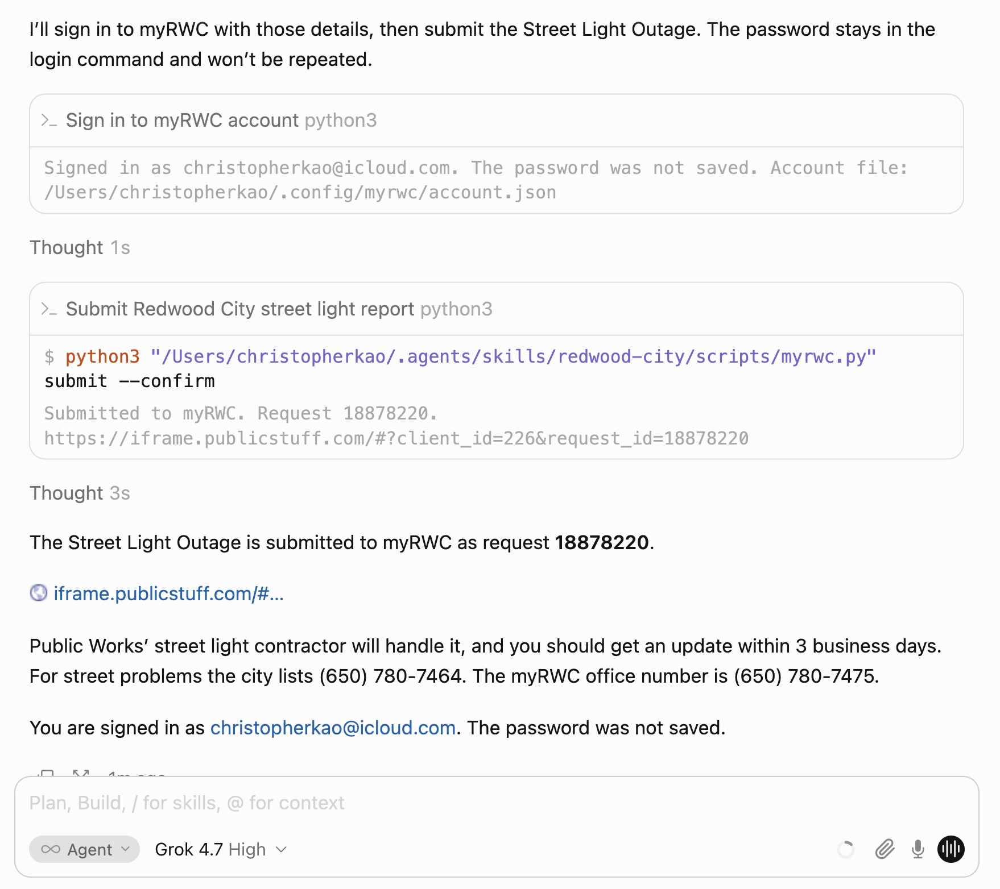

# Redwood City 311 runs

Camera-photo runs for Redwood City. This file does not cover other jurisdictions. [`catalog.md`](catalog.md) links here from the Run column.

The agent follows [`skills/redwood-city/SKILL.md`](../../skills/redwood-city/SKILL.md). `list` and `show` only read `catalog.json`. `prepare` calls the Esri geocoder and writes `~/.config/myrwc/preview.json`. `submit --confirm` is the only command that files the report. It POSTs to myRWC. `login` is a separate POST, and only when that account file is missing.

Street Light Outage is also covered offline by [`tests/test_redwood_city_street_light.py`](../../tests/test_redwood_city_street_light.py). That test uses a stand-in photo and does not call the city.

## Street light broken, November 8, 2026

Submitted. myRWC request [18878220](https://iframe.publicstuff.com/#?client_id=226&request_id=18878220).

Catalog type: [Street Light Outage](catalog.md#street-light-outage), id 27267.

The photo is a night street market on Broadway. White vendor tents line the sidewalk. A black decorative lamp post stands in the foreground, and the lamp is lit. The original camera file is `5C6FDD59-583D-4AC5-BCBA-E3EE9AB03CBD_4_5005_c-d604cab8-56d7-402b-aaeb-a5d14d069140.jpg`.

### Chat

**Christopher:** Can you do a dry run of reporting this street light broken in redwood city?

**Assistant:** This is a dry run only. Nothing was sent to Redwood City.

Street Light Outage. The catalog describes this as "Street light bulb out." If you submit it, Public Works' street light contractor gets the report, and you would get an update within 3 business days.

- Address: 2206 Broadway St, Redwood City, CA 94063
- Cross street: Broadway St & Middlefield Rd
- Description: Street light is broken.
- Please provide street name and Cross Street.: Broadway St & Middlefield Rd

That cross-street line is filled in for city staff. The report is private. Name and phone are not fields on a street light. They come from the myRWC account only if you later sign in and submit. The photo and the location would be sent with the report.

The lamp in the photo is lit.



**Christopher:** Ok please proceed with submitting.

**Assistant:** The Street Light Outage preview is ready, but this Mac has no myRWC sign-in yet, so the report was not submitted. Send the myRWC email, password, name, and phone.



**Christopher:** Sent the myRWC email christopherkao@icloud.com, the password, the name Christopher Kao, and the phone. The password is not written here.

**Assistant:** The Street Light Outage is submitted to myRWC as request 18878220. https://iframe.publicstuff.com/#?client_id=226&request_id=18878220

Public Works' street light contractor will handle it, and you should get an update within 3 business days. For street problems the city lists (650) 780-7464. The myRWC office number is (650) 780-7475.

You are signed in as christopherkao@icloud.com. The password was not saved.



### What the skill did

1. Street Light Outage is the skill's request type for a street light that is out, id 27267. The catalog description is "Street light bulb out." The confirmation says Public Works' street light maintenance contractor will repair it, with an update within 3 business days. `show` would list "Please provide street name and Cross Street." (3346) as required and staff-only. That lookup is local. It does not call myRWC.

2. `prepare` used the original JPEG. The command was:

```bash
python3 skills/redwood-city/scripts/myrwc.py prepare \
  --photo "/path/to/5C6FDD59-583D-4AC5-BCBA-E3EE9AB03CBD_4_5005_c-d604cab8-56d7-402b-aaeb-a5d14d069140.jpg" \
  --type "Street Light Outage" \
  --description "Street light is broken."
```

`prepare` read the GPS from the JPEG in Python: 37.486697222222226, -122.22925555555555. It then called Esri's public reverse geocoder twice:

```
GET https://geocode.arcgis.com/arcgis/rest/services/World/GeocodeServer/reverseGeocode?f=json&location=-122.22925555555555,37.486697222222226
GET https://geocode.arcgis.com/arcgis/rest/services/World/GeocodeServer/reverseGeocode?f=json&featureTypes=StreetInt&location=-122.22925555555555,37.486697222222226
```

The first response had to be inside Redwood City. It returned 2206 Broadway St, Redwood City, CA 94063. The second, limited to street intersections, returned Broadway St & Middlefield Rd. The skill copied that corner into "Please provide street name and Cross Street.", field 3346. The description was `Street light is broken.` It wrote the preview to `~/.config/myrwc/preview.json` with mode 600. `prepare` does not send the report.

3. `~/.config/myrwc/account.json` was missing, so this run signed in before submit. `login` read `MYRWC_EMAIL`, `MYRWC_PASSWORD`, `MYRWC_NAME`, and `MYRWC_PHONE` and POSTed:

```
POST https://vc0.publicstuff.com/api/2.1/user_login
PublicStuff-Client: 226
Content-Type: application/x-www-form-urlencoded
```

The form included `email`, `password`, `device` iframe, and `client_id` 226. The saved file holds the email, name, phone, and API key, with mode 600. The password is not saved. The account on this run was christopherkao@icloud.com, name Christopher Kao.

4. After the preview was confirmed and the account was saved, `submit --confirm` read that preview, called the same two reverse-geocode URLs again to check the pin was still in Redwood City, and POSTed the report:

```
POST https://vc0.publicstuff.com/api/2.0/request_submit
PublicStuff-Client: 226
Content-Type: multipart/form-data
```

The form included `title` Street Light Outage, `description` Street light is broken., `request_type_id` 27267, the photo latitude and longitude, the formatted address in `address`, `user_address`, and `long_address`, `zipcode` 94063, `space_id` 29066, `client_id` 226, `device` iframe, the saved API key, `has_image` 1, and the photo as `uploadedfile`. The cross street went out as `custom_field_3346`, JSON-encoded. Name and phone are not fields on a street light, so they were not sent. The script does not send `is_private`. The city already forces every myRWC request private. The script treats the call as successful when `response.status.code` is 200. myRWC returned request 18878220 and this URL:

https://iframe.publicstuff.com/#?client_id=226&request_id=18878220
